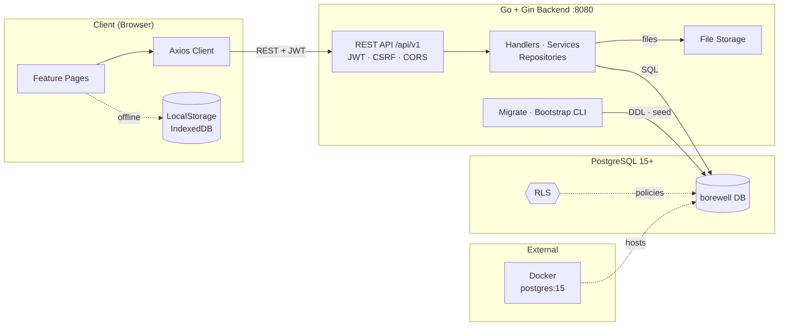

# Borewell Visualizer

Interactive web application for visualizing and documenting borehole construction. Designed for geotechnical engineers, hydrogeologists, and field technicians to design, monitor, and report borehole specifications visually and systematically.
 
## Features

### Project & Well Management
- Create, edit, archive, restore, duplicate, and delete projects with validation
- Multiple wells per project with types (production, monitoring, exploration, test) and statuses (planned, drilling, completed, on hold, abandoned)
- Data isolation per project and well — no cross-contamination
- Automatic legacy data migration with backup

### Well Designer
- Modular components: surface casing, production casing, blank casing, screen pipe, open hole, gravel pack, cement grouting
- Markers: well cap, submersible pump, pump position, water level
- Technical validation: overlap detection, diameter validation, depth range checking
- Undo/redo history (max 50) with keyboard shortcuts
- Autosave (1.5s debounce)
- Export canvas as PNG

### Geological Log
- Multiple layers with material, depth, description, formation
- 10+ material categories: topsoil, clay, silt, sand, gravel, sandstone, limestone, shale, granite, basalt
- Proportional canvas visualization with depth scale
- Validation: overlap warnings, gap warnings, depth-out-of-bounds
- Summary: total layers, filled intervals, maximum depth

### Groundwater Monitoring
- Water level measurements: timestamp, depth, reference point (TOC/GL), reference elevation, method, status, notes
- Interactive hydrograph: time-series chart with depth and time axes
- Statistics: min, max, average, last change, estimated water level elevation
- CSV import/export with validation, preview, duplicate ID handling
- Mixed reference point detection
- Per-well data isolation

### Documentation & Reporting
- Photo gallery: 10 categories, max 3 per category
- Document management: 10 categories (permits, contracts, test results, daily reports, as-built, etc.)
- Drag-and-drop upload with MIME validation (JPG, PNG, WebP, PDF, TXT), size limits (10MB photos, 20MB documents)
- IndexedDB for large files (>2MB), localStorage for smaller files (base64)
- Preview: images, PDF iframe, metadata (category, size, date, description)
- Search and filter by name/description, category, sort (date, name, size)
- Grid/list view toggle
- Automatic legacy photo/activity migration

### Professional Report Builder
- 7 report sections: Cover, Project & Well Info, Well Construction, Geological Log, Groundwater Monitoring, Field Documentation, Notes & Conclusion
- Selective photo inclusion
- Report metadata: title, number, revision, date, prepared by, reviewed by, company logo
- Rich text editor for technical notes and conclusions
- Live HTML preview before PDF export
- Multi-page PDF: construction diagram, geological tables, hydrograph, photo gallery, signatures

### Data Management, Backup & Restore
- Complete backup: ZIP archive (manifest.json + localStorage JSON + IndexedDB assets)
- Full replace: replace all data with backup (automatic safety backup + rollback)
- Merge: combine backup with existing data (conflict detection on project/well codes)
- Safety backup: automatic before restore, manual recovery via UI
- Partial export: Projects (JSON), Well (JSON), Monitoring (CSV), Geology (CSV), Docs metadata (JSON)
- Import: Projects (JSON), Well (JSON) with validation
- Storage health: monitor localStorage/IndexedDB usage, quota, warnings (>60% warning, >80% critical)
- Data integrity: duplicate ID detection, orphaned documents, broken references, invalid values
- Safe repair: preview with confirmation (rename duplicate wells, remove orphaned wells)

## Technology Stack

| Layer | Technology |
|-------|------------|
| Frontend | React 18 + Vite 5 |
| Icons | Lucide React |
| Styling | Pure CSS (technical paper theme, Grid/Flexbox, responsive desktop & mobile) |
| Visualization | Canvas API (pipes, screens, open hole, MAT, ground surface, depth scale, geological log, hydrograph) |
| PDF Export | jsPDF |
| Archive | JSZip |
| Client Storage | localStorage (auto-save), IndexedDB (binary files >2MB) |
| File API | FileReader (validation, preview, max file size) |
| Backend | Go 1.22 + Gin |
| Database | PostgreSQL 15+ |
| Auth | JWT (15min access, 30d refresh in HttpOnly cookie), Argon2id |
| Migrations | 13 SQL migrations (users, projects, wells, files, RLS, triggers, indexes) |
| Security | Row Level Security (project/well isolation, fail-closed), CSRF, Rate limiting |

## Architecture



The application runs in two modes:

**Frontend-only (LocalStorage/IndexedDB)** — Fully offline after initial load. No backend required. Feature pages read and write LocalStorage, and photos or documents above 2 MB go to IndexedDB.

**Full-stack (Go + PostgreSQL)** — Multi-user with authentication, project/well isolation via RLS, file storage with SHA-256 deduplication, and REST API.

**Communication:**

- **REST** — `/api/v1` for auth, projects, wells, modules, documentation, backup, and admin. Access token travels in the `Authorization` header; the refresh token stays in an HttpOnly cookie.
- **Middleware** — request ID, CORS allow-list, CSRF check on state-changing methods, JWT validation, and per-IP rate limiting run before any handler.
- **Data access** — handlers delegate to services, services to repositories. Every query runs inside PostgreSQL with RLS policies scoped to the active user's project and well.
- **File storage** — the documentation service writes to `FILE_STORAGE_PATH`, validates MIME type and size, and stores a SHA-256 checksum for deduplication.
- **Operations** — `cmd/migrate` applies the 13 versioned migrations, `cmd/bootstrap-admin` seeds the first approved administrator, and Docker only hosts the local PostgreSQL container.

## Quick Start

### Frontend Only
```bash
npm install
npm run dev          # Development server at http://localhost:5173
npm run build        # Production build to dist/
npm run preview      # Preview production build
```

### Full-Stack Mode

**Requirements:** Go 1.22+, Node.js 20+, PostgreSQL 15+, Docker (optional)

**Backend Setup:**
```bash
cd backend
cp .env.example .env
# Edit .env with DATABASE_URL, JWT_SECRET, REFRESH_TOKEN_SECRET, etc.
docker run --name postgres-borewell \
  -e POSTGRES_DB=borewell \
  -e POSTGRES_USER=postgres \
  -e POSTGRES_PASSWORD=password \
  -p 5432:5432 -d postgres:15
./bin/migrate up
./bin/bootstrap-admin -email admin@example.com -password "StrongPassword123"
./bin/server
```

**Frontend Setup:**
```bash
npm install
npm run dev          # Proxies /api to backend at http://127.0.0.1:8080
```

## Testing

```bash
# Frontend verification scripts
node tests/phase2_verify.mjs   # Project & Well Management
node tests/phase3_verify.mjs   # Advanced Well Designer
node tests/phase4_verify.mjs   # Geological Log
node tests/phase5_verify.mjs   # Groundwater Monitoring
node tests/phase7_verify.mjs   # Data Management, Backup & Restore
node tests/pdf_verify.mjs      # PDF Generation

# Backend tests
cd backend
go test ./...                  # Auth, RLS, Security, Refresh tokens, FS3
```

## Storage Architecture

**LocalStorage Keys:**
- `borewell-projects:v1` — Project list + active project/well IDs
- `borewell-project-{id}:v1` — Individual project record
- `borewell-well-{id}:v1` — Well data (well, model, activity)
- `borewell-project-docs:v1` — Project-level documentation
- `borewell-well-docs-{wellId}:v1` — Well-level documentation
- `borewell-migration:v1` — Migration status flag
- `borewell-safety-backup:v1` — Safety backup for restore
- `borewell-backup-history:v1` — Local backup history (max 50)

**IndexedDB:** `BorewellDocsDB` (v1) with `photos` and `documents` object stores (key: `id`), storing binary files as base64 data URLs.

## Security & Privacy

- **Frontend-only mode:** No backend, cloud database, or paid APIs. All data stays in the user's browser.
- **File validation:** MIME type, extension, and size validated before storage.
- **CSV sanitization:** Formula injection prevention on export.
- **Path traversal protection:** ZIP extraction with `filepath.Clean` and path verification.
- **Offline-first:** Works completely offline after initial load.
- **Backend mode:** RLS enforces project/well isolation at database level. JWT in memory, refresh token in HttpOnly cookie. Argon2id password hashing. CSRF protection on state-changing endpoints.

## Responsive Design & Accessibility

| Breakpoint | Layout |
|------------|--------|
| ≥1200px | Full 3-column (toolbar, canvas, properties) |
| 768–1199px | 2-column, properties panel hidden |
| <768px | Single column, bottom tab bar, drawer sidebar, dialog bottom-sheet |

- Keyboard navigation: visible focus, logical tab order, Escape to close dialogs
- Semantic HTML: `<button>`, `<nav>`, `<main>`, `<section>`, `<dialog>`, form elements
- ARIA: labels, roles, `aria-current`, `aria-disabled`, `aria-live`
- Color contrast meets WCAG AA
- Respects `prefers-reduced-motion`

## Performance

- Bundle size: ~517 KB (gzipped ~144 KB)
- Code splitting: vendor chunks (jsPDF, JSZip, html2canvas)
- Lazy loading: heavy libraries load on demand
- Autosave debounce: 1.5s reduces storage writes
- Canvas optimization: `requestAnimationFrame`, offscreen rendering
- IndexedDB async: non-blocking file operations

## Documentation

| File | Description |
|------|-------------|
| `README.md` | This file |
| `PHASE6_IMPLEMENTATION_SUMMARY.md` | Phase 6 implementation details |
| `PHASE7_COMPLETION_REPORT.md` | Phase 7 completion report |
| `PHASE_3.1_COMPLETION_REPORT.md` | Designer & legacy integration |
| `tasks/plan.md` | Overall development plan |
| `tasks/todo.md` | Task list |
| `tasks/phase7_plan.md` | Phase 7 plan |
| `API_SPECIFICATION.md` | REST API specification |
| `DATABASE_SCHEMA_DESIGN.md` | Database schema |
| `DATA_MIGRATION_PLAN.md` | Migration strategy |
| `FULLSTACK_ARCHITECTURE.md` | Full-stack architecture |
| `FULLSTACK_ROADMAP.md` | Roadmap |

## Operational Documentation

### Authentication & Approval

**New User Registration:**
1. Open Register page, enter email, password (min 12 chars), confirm password, full name
2. Account created with `pending` status — awaits admin approval
3. Admin logs into Admin Approval page (`/admin-approval`)
4. Admin approves/rejects user; user receives status notification

**Login:**
1. Enter email & password on Login page
2. Access token (JWT, 15 min) stored in memory (not localStorage)
3. Refresh token (30 days) stored in HttpOnly cookie
4. Automatic token refresh before API requests

**Logout:** Clears access token, revokes refresh token server-side, removes cookie.

### Backup & Restore

**Backend (Database + Files):**
```bash
# Backup database
pg_dump -h localhost -U postgres -d borewell -Fc -f borewell_backup_$(date +%Y%m%d_%H%M%S).dump

# Restore database
pg_restore -h localhost -U postgres -d borewell -c borewell_backup_20260101_120000.dump

# Backup file storage
tar -czf files_backup_$(date +%Y%m%d_%H%M%S).tar.gz ./data/files
```

**Frontend (via UI — Data Management page):**
- Tab "Backup & Restore" → "Create & Download Backup" → ZIP file
- Backup includes: projects, wells, designer, geology, monitoring, photos, documents, IndexedDB assets
- Restore: select ZIP → choose "Full Replace" or "Merge" → confirm
- Safety backup created automatically before restore; recoverable via "Restore Safety Backup"

**Consistency:** Database and file storage backups must run simultaneously for metadata-file consistency.

### File Storage

- Location: `FILE_STORAGE_PATH` from `.env` (default: `backend/data/files/`)
- Structure: `photos/{uuid}.{ext}`, `documents/{uuid}.{ext}`
- Validation: MIME type (content-based via `mimetype` lib), extension, size (photos 10MB, documents 20MB)
- Path traversal protection: `filepath.Clean` + verification under `FILE_STORAGE_PATH`
- SHA-256 checksum stored for deduplication and integrity verification

### Legacy Migration

**Migration Wizard (Data Management → Legacy Migration):**
1. Click "Scan Legacy Data" — detects legacy localStorage/IndexedDB data
2. Review preview: project count, well count, photos, documents, code conflicts
3. Choose: "Skip Conflicts" or auto-rename (`-IMPORT` suffix)
4. Click "Import" — transactional migration to backend
5. Results: imported/skipped/errors per item

**Note:** One-way migration (legacy → backend). Legacy data remains in browser until manually cleared.

## Troubleshooting

| Issue | Cause & Solution |
|-------|------------------|
| Frontend can't connect to backend | Verify backend running on port 8080, check Vite proxy config |
| Login fails "Invalid credentials" | Check user status `approved`, correct password, DB accessibility |
| Refresh token 401 repeatedly | Cookie not sent (check SameSite, Secure, domain), clear browser cookies |
| Upload fails "Invalid MIME type" | File corrupt or disallowed format; check `mimetype` detection |
| Backup restore fails | Verify manifest.json format, version compatibility, disk space |
| RLS "permission denied" | Ensure RLS migrations applied (`goose up`), user context set via `SET LOCAL` |
| Build chunk size warning | Optimized via `manualChunks` in `vite.config.js` |

### Shutdown

1. **Frontend (Vite dev server):** `Ctrl+C` in Vite terminal
2. **Backend (Go server):** `Ctrl+C` in backend terminal — graceful shutdown 30s timeout
3. **PostgreSQL (Docker):** `docker stop postgres-borewell` → `docker rm postgres-borewell`
4. **PostgreSQL (Manual/Systemd):** `systemctl stop postgresql` or `pg_ctl stop`

**Important:** Stop backend before PostgreSQL to avoid interrupted transactions.

## Application Identity

- **Name:** Borewell Visualizer / Visualisasi Pipa Sumur Bor
- **Version:** 2.0.0
- **Favicon:** `img/tubes.png`
- **Title:** "Visualisasi Pipa Sumur Bor"
- **Brand:** "Borewell Visualizer" (sidebar), "Sumur Bor — Visualisasi konstruksi" (topbar)

## Known Limitations

1. **Report preview:** HTML preview simplified — PDF output more sophisticated
2. **IndexedDB in tests:** Mocked in test environment
3. **Large file fallback:** Base64 in localStorage if IndexedDB unavailable
4. **Migration one-way:** Legacy → modern, no rollback to legacy
5. **Offline-only (frontend mode):** No cloud sync or multi-device support
6. **Single user (frontend mode):** No authentication or multi-user support
7. **Backend production hardening:** HTTPS, production secrets, deployment not verified (local only)

## Future Enhancements (Out of Scope)

- Batch operations (multi-select delete/download)
- Custom report templates
- Digital signature support
- Cloud sync/backup
- OCR for scanned documents
- Multi-language support
- Advanced charting (drill-down, annotations)

