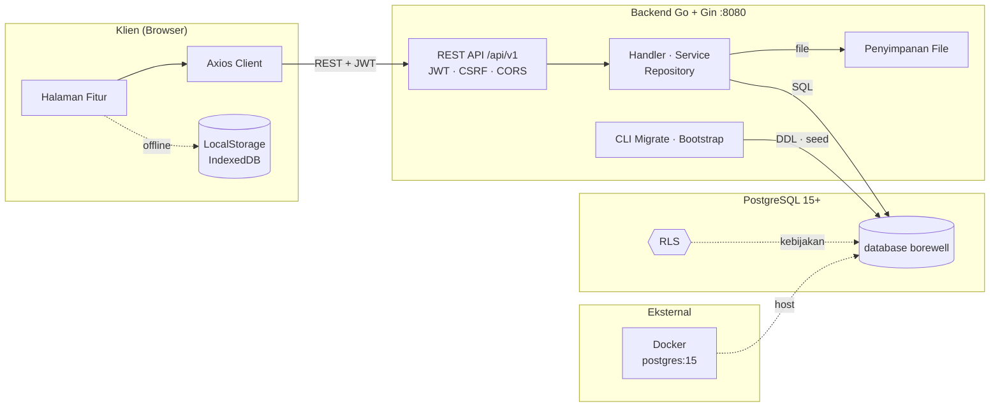

# Borewell Visualizer

Aplikasi web interaktif untuk memvisualisasikan dan mendokumentasikan konstruksi sumur bor. Dirancang untuk insinyur geoteknik, hidrogeolog, dan teknisi lapangan dalam merancang, memantau, serta menyusun laporan spesifikasi sumur bor secara visual dan sistematis.

## Fitur

### Manajemen Proyek & Sumur
- Membuat, mengubah, mengarsipkan, memulihkan, menduplikasi, dan menghapus proyek dengan validasi
- Banyak sumur per proyek dengan tipe (produksi, pemantauan, eksplorasi, uji) dan status (direncanakan, pengeboran, selesai, ditunda, ditinggalkan)
- Isolasi data per proyek dan sumur — tidak ada data yang tercampur antar proyek
- Migrasi otomatis data lama disertai cadangan

### Desainer Sumur
- Komponen modular: casing permukaan, casing produksi, blank casing, pipa screen, open hole, gravel pack, dan semen grouting
- Penanda: tutup sumur, pompa submersible, posisi pompa, dan muka air
- Validasi teknis: deteksi tumpang tindih, validasi diameter, dan pemeriksaan rentang kedalaman
- Riwayat undo/redo (maksimal 50) dengan pintasan papan ketik
- Simpan otomatis (debounce 1,5 detik)
- Ekspor kanvas sebagai PNG
- Kanvas responsif (lebar 240–700 px) dengan kolom ruler dan label yang menyesuaikan pada layar sempit
- Label komponen tidak bertumpuk: ditumpuk dengan jarak minimum, garis penunjuk bersiku, dan pemotongan teks dengan elipsis
- Panel properti: panjang interval dihitung otomatis, pemilih warna native + input hex, dan kolom numerik tetap berupa angka

### Log Geologi
- Banyak lapisan dengan material, kedalaman, deskripsi, dan formasi
- 10+ kategori material: topsoil, clay, silt, sand, gravel, sandstone, limestone, shale, granite, basalt
- Visualisasi kanvas proporsional dengan skala kedalaman
- Validasi: peringatan tumpang tindih, peringatan celah kosong, dan kedalaman di luar batas
- Ringkasan: jumlah lapisan, interval terisi, dan kedalaman maksimum

### Pemantauan Air Tanah
- Pengukuran muka air: waktu, kedalaman, titik acuan (TOC/GL), elevasi acuan, metode, status, dan catatan
- Hidrograf interaktif: grafik deret waktu dengan sumbu kedalaman dan waktu
- Statistik: minimum, maksimum, rata-rata, perubahan terakhir, dan estimasi elevasi muka air
- Impor/ekspor CSV dengan validasi, pratinjau, dan penanganan ID duplikat
- Deteksi titik acuan campuran
- Isolasi data per sumur

### Dokumentasi & Pelaporan
- Galeri foto: 10 kategori, maksimal 3 foto per kategori
- Manajemen dokumen: 10 kategori (perizinan, kontrak, hasil uji, laporan harian, as-built, dan lain-lain)
- Unggah drag-and-drop dengan validasi MIME (JPG, PNG, WebP, PDF, TXT) dan batas ukuran (foto 10 MB, dokumen 20 MB)
- IndexedDB untuk file besar (>2 MB), localStorage untuk file kecil (base64)
- Pratinjau: gambar, iframe PDF, dan metadata (kategori, ukuran, tanggal, deskripsi)
- Pencarian dan filter berdasarkan nama/deskripsi, kategori, serta pengurutan (tanggal, nama, ukuran)
- Tampilan grid/list yang dapat diganti
- Migrasi otomatis foto dan aktivitas lama

### Penyusun Laporan Profesional
- 7 bagian laporan: Sampul, Info Proyek & Sumur, Konstruksi Sumur, Log Geologi, Pemantauan Air Tanah, Dokumentasi Lapangan, serta Catatan & Kesimpulan
- Pemilihan foto secara selektif, disematkan langsung ke PDF
- Metadata laporan: judul, nomor, revisi, tanggal, disusun oleh, diperiksa oleh, dan logo perusahaan
- Editor teks untuk catatan teknis dan kesimpulan
- Pratinjau HTML sebelum ekspor PDF
- PDF multi-halaman: diagram konstruksi, tabel geologi, hidrograf, galeri foto, dan kolom tanda tangan
- Generator PDF modular di `src/pdf-kit` (mesin layout, diagram, dan bagian laporan terpisah)

### Manajemen Data, Cadangan & Pemulihan
- Cadangan lengkap: arsip ZIP (manifest.json + JSON localStorage + aset IndexedDB)
- Ganti total: mengganti seluruh data dengan cadangan (cadangan keamanan otomatis + rollback)
- Gabung: menggabungkan cadangan dengan data yang ada (deteksi konflik kode proyek/sumur)
- Cadangan keamanan: dibuat otomatis sebelum pemulihan, dapat dipulihkan lewat UI
- Ekspor sebagian: Proyek (JSON), Sumur (JSON), Pemantauan (CSV), Geologi (CSV), dan metadata dokumen (JSON)
- Impor: Proyek (JSON) dan Sumur (JSON) dengan validasi
- Kesehatan penyimpanan: pemantauan pemakaian localStorage/IndexedDB, kuota, dan peringatan (>60% waspada, >80% kritis)
- Integritas data: deteksi ID duplikat, dokumen yatim, referensi rusak, dan nilai tidak valid
- Perbaikan aman: pratinjau dengan konfirmasi (ganti nama sumur duplikat, hapus sumur yatim)

## Teknologi

| Lapisan | Teknologi |
|---------|-----------|
| Frontend | React 18 + Vite 5 |
| Ikon | Lucide React |
| Styling | CSS murni (tema kertas teknis, Grid/Flexbox, responsif desktop & mobile) |
| Visualisasi | Canvas API (pipa, screen, open hole, MAT, permukaan tanah, skala kedalaman, log geologi, hidrograf) |
| Ekspor PDF | jsPDF |
| Arsip | JSZip |
| Penyimpanan klien | localStorage (simpan otomatis), IndexedDB (file biner >2 MB) |
| File API | FileReader (validasi, pratinjau, batas ukuran file) |
| Backend | Go 1.22 + Gin |
| Database | PostgreSQL 15+ |
| Autentikasi | JWT (akses 15 menit, refresh 30 hari di cookie HttpOnly), Argon2id |
| Migrasi | 16 migrasi SQL (users, projects, wells, files, RLS, trigger, indeks, project_assignments) |
| Keamanan | Row Level Security (isolasi proyek/sumur, fail-closed), CSRF, rate limiting |

## Arsitektur



Aplikasi berjalan dalam dua mode:

**Frontend saja (LocalStorage/IndexedDB)** — Sepenuhnya offline setelah pemuatan awal. Tidak memerlukan backend. Halaman fitur membaca dan menulis localStorage, sedangkan foto atau dokumen di atas 2 MB disimpan di IndexedDB.

**Full-stack (Go + PostgreSQL)** — Multi-pengguna dengan autentikasi, isolasi proyek/sumur melalui RLS, penyimpanan file dengan deduplikasi SHA-256, dan REST API.

**Komunikasi:**

- **REST** — `/api/v1` untuk autentikasi, proyek, sumur, modul, dokumentasi, cadangan, dan admin. Access token dikirim melalui header `Authorization`; refresh token disimpan di cookie HttpOnly.
- **Middleware** — request ID, allow-list CORS, pemeriksaan CSRF pada metode yang mengubah data, validasi JWT, dan rate limiting per IP dijalankan sebelum handler.
- **Akses data** — handler memanggil service, service memanggil repository. Setiap kueri berjalan di PostgreSQL dengan kebijakan RLS sesuai proyek dan sumur pengguna aktif.
- **Penyimpanan file** — service dokumentasi menulis ke `FILE_STORAGE_PATH`, memvalidasi MIME dan ukuran, lalu menyimpan checksum SHA-256 untuk deduplikasi.
- **Operasional** — `cmd/migrate` menjalankan migrasi berversi, `cmd/bootstrap-admin` membuat administrator pertama, dan Docker hanya menjalankan kontainer PostgreSQL lokal.

## Mulai Cepat

### Frontend Saja
```bash
npm install
npm run dev          # Server pengembangan di http://localhost:5173
npm run build        # Build produksi ke dist/
npm run preview      # Pratinjau hasil build produksi
```

### Mode Full-Stack

**Kebutuhan:** Go 1.22+, Node.js 20+, PostgreSQL 15+, Docker (opsional)

**Menyiapkan backend:**
```bash
cd backend
cp .env.example .env
# Sesuaikan .env: DATABASE_URL, JWT_SECRET, REFRESH_TOKEN_SECRET, dll.
docker compose up -d postgres

# Jalankan langsung dari source (disarankan) …
go run ./cmd/migrate up
go run ./cmd/bootstrap-admin --email admin@example.com --password "StrongPassword123"
go run ./cmd/server

# … atau build binary lokal sekali (di-ignore git):
# go build -o bin/migrate.exe ./cmd/migrate && go build -o bin/server.exe ./cmd/server
```

**Menyiapkan frontend:**
```bash
npm install
npm run dev          # Proxy /api ke backend di http://127.0.0.1:8080
```

## Pengujian

```bash
# Unit / integrasi frontend (Vitest + Testing Library)
npm test

# Uji end-to-end (Playwright)
npx playwright test

# Uji backend (auth, RLS, keamanan, refresh token, admin & penugasan)
cd backend
go test ./...

# Skrip verifikasi browser lama
node tests/phase2_verify.mjs   # Manajemen Proyek & Sumur
node tests/phase3_verify.mjs   # Desainer Sumur Lanjutan
node tests/phase4_verify.mjs   # Log Geologi
node tests/phase5_verify.mjs   # Pemantauan Air Tanah
node tests/phase7_verify.mjs   # Manajemen Data, Cadangan & Pemulihan
node tests/pdf_verify.mjs      # Pembuatan PDF
```

## Arsitektur Penyimpanan

**Kunci LocalStorage:**
- `borewell-projects:v1` — Daftar proyek + ID proyek/sumur aktif
- `borewell-project-{id}:v1` — Data satu proyek
- `borewell-well-{id}:v1` — Data sumur (well, model, activity)
- `borewell-project-docs:v1` — Dokumentasi tingkat proyek
- `borewell-well-docs-{wellId}:v1` — Dokumentasi tingkat sumur
- `borewell-migration:v1` — Penanda status migrasi
- `borewell-safety-backup:v1` — Cadangan keamanan untuk pemulihan
- `borewell-backup-history:v1` — Riwayat cadangan lokal (maksimal 50)

**IndexedDB:** `BorewellDocsDB` (v1) dengan object store `photos` dan `documents` (key: `id`), menyimpan file biner sebagai data URL base64.

## Keamanan & Privasi

- **Mode frontend saja:** Tanpa backend, database cloud, atau API berbayar. Seluruh data tetap di browser pengguna.
- **Validasi file:** MIME, ekstensi, dan ukuran divalidasi sebelum disimpan.
- **Sanitasi CSV:** Pencegahan formula injection saat ekspor.
- **Perlindungan path traversal:** Ekstraksi ZIP dengan `filepath.Clean` dan verifikasi path.
- **Offline-first:** Berfungsi penuh secara offline setelah pemuatan awal.
- **Mode backend:** RLS menegakkan isolasi proyek/sumur di level database. JWT disimpan di memori, refresh token di cookie HttpOnly. Password di-hash dengan Argon2id. Endpoint yang mengubah data dilindungi CSRF.

## Desain Responsif & Aksesibilitas

| Breakpoint | Tata Letak |
|------------|------------|
| ≥1200px | 3 kolom penuh (toolbar, kanvas, properti) |
| 768–1199px | 2 kolom, panel properti disembunyikan |
| <768px | Satu kolom, tab bar bawah, sidebar drawer, dialog bottom-sheet |

- Navigasi papan ketik: fokus terlihat, urutan tab logis, Escape untuk menutup dialog
- HTML semantik: `<button>`, `<nav>`, `<main>`, `<section>`, `<dialog>`, dan elemen form
- ARIA: label, role, `aria-current`, `aria-disabled`, `aria-live`
- Kontras warna memenuhi WCAG AA
- Menghormati `prefers-reduced-motion`

## Performa

- Ukuran bundle: chunk utama ±476 KB (gzip ±127 KB) ditambah chunk vendor terpisah
- Code splitting: chunk vendor (jsPDF, JSZip, html2canvas)
- Lazy loading: pustaka berat dimuat sesuai kebutuhan
- Debounce simpan otomatis 1,5 detik untuk menekan penulisan penyimpanan
- Optimasi kanvas: `requestAnimationFrame` dan rendering offscreen
- IndexedDB asinkron: operasi file tidak memblokir UI

## Dokumentasi

| File | Deskripsi |
|------|-----------|
| `README.md` | Dokumen ini |
| `docs/ARCHITECTURE.md` | Arsitektur final: manajemen akun, penugasan proyek, RLS, migrasi, navigasi |
| `docs/USER_AND_ROLE_MANAGEMENT.md` | Peran, izin, dan siklus hidup akun |
| `backend/README.md` | Mulai cepat, struktur, dan konfigurasi backend |
| `backend/AUTHENTICATION.md` | Login, rotasi refresh token, dan penanganan sesi |
| `backend/SESSION_SECURITY.md` | Token family, pencabutan token, dan kebijakan cookie |
| `backend/ADMIN_APPROVAL.md` | Persetujuan pengguna dan manajemen akun oleh admin |
| `backend/DATABASE_MIGRATION.md` | Alur migrasi dan perubahan skema |
| `backend/DOCKER_SETUP.md` | Penyiapan kontainer PostgreSQL |

## Panduan Operasional

### Autentikasi & Persetujuan Akun

Akun dibuat oleh administrator — tidak ada endpoint pendaftaran mandiri untuk publik.

**Membuat pengguna (admin):**
1. Login sebagai admin, buka **User Management**
2. Buat akun STAFF atau ADMIN dengan password minimal 12 karakter
3. Akun baru langsung berstatus `approved` dan dapat di-suspend atau diaktifkan kembali

**Login:**
1. Masukkan email & password di halaman Login
2. Access token (JWT, 15 menit) disimpan di memori (bukan localStorage)
3. Refresh token (30 hari) disimpan di cookie HttpOnly dan dirotasi setiap refresh
4. Akun yang di-suspend atau ditolak akan ditolak saat login *dan* saat refresh

**Logout:** Menghapus access token, mencabut refresh token di server, dan menghapus cookie.

**Penugasan proyek (admin):** tugaskan staff ke proyek dengan izin `view` atau `edit` lewat **Project Assignment**. Staff hanya melihat proyek yang ditugaskan; UUID proyek lain tidak mengembalikan data (RLS fail-closed).

### Cadangan & Pemulihan

**Backend (database + file):**
```bash
# Cadangkan database
pg_dump -h localhost -U postgres -d borewell -Fc -f borewell_backup_$(date +%Y%m%d_%H%M%S).dump

# Pulihkan database
pg_restore -h localhost -U postgres -d borewell -c borewell_backup_20260101_120000.dump

# Cadangkan penyimpanan file
tar -czf files_backup_$(date +%Y%m%d_%H%M%S).tar.gz ./data/files
```

**Frontend (melalui UI — halaman Data Management):**
- Tab "Backup & Restore" → "Create & Download Backup" → file ZIP
- Isi cadangan: proyek, sumur, desainer, geologi, pemantauan, foto, dokumen, dan aset IndexedDB
- Pemulihan: pilih ZIP → tentukan "Full Replace" atau "Merge" → konfirmasi
- Cadangan keamanan dibuat otomatis sebelum pemulihan; dapat dipulihkan lewat "Restore Safety Backup"

**Konsistensi:** Cadangan database dan penyimpanan file harus dijalankan bersamaan agar metadata selaras dengan file.

### Penyimpanan File

- Lokasi: `FILE_STORAGE_PATH` dari `.env` (default: `backend/data/files/`)
- Struktur: `photos/{uuid}.{ext}`, `documents/{uuid}.{ext}`
- Validasi: MIME (berbasis konten via pustaka `mimetype`), ekstensi, dan ukuran (foto 10 MB, dokumen 20 MB)
- Perlindungan path traversal: `filepath.Clean` + verifikasi di dalam `FILE_STORAGE_PATH`
- Checksum SHA-256 disimpan untuk deduplikasi dan verifikasi integritas

### Migrasi Data Lama

**Wizard Migrasi (Data Management → Legacy Migration):**
1. Klik "Scan Legacy Data" — mendeteksi data lama di localStorage/IndexedDB
2. Tinjau pratinjau: jumlah proyek, jumlah sumur, foto, dokumen, dan konflik kode
3. Pilih: "Skip Conflicts" atau ganti nama otomatis (akhiran `-IMPORT`)
4. Klik "Import" — migrasi transaksional ke backend
5. Hasil: jumlah berhasil/dilewati/galat per item

**Catatan:** Migrasi bersifat satu arah (lama → backend). Data lama tetap ada di browser sampai dihapus manual.

## Pemecahan Masalah

| Masalah | Penyebab & Solusi |
|---------|-------------------|
| Frontend tidak bisa terhubung ke backend | Pastikan backend berjalan di port 8080 dan periksa konfigurasi proxy Vite |
| Login gagal "Invalid credentials" | Periksa status pengguna `approved`, password, dan akses database |
| Refresh token 401 berulang | Cookie tidak terkirim (periksa SameSite, Secure, domain); bersihkan cookie browser |
| Unggah gagal "Invalid MIME type" | File rusak atau format tidak diizinkan; periksa deteksi `mimetype` |
| Pemulihan cadangan gagal | Verifikasi format manifest.json, kompatibilitas versi, dan ruang disk |
| RLS "permission denied" | Pastikan migrasi RLS sudah diterapkan (`goose up`) dan konteks pengguna di-set via `SET LOCAL` |
| Peringatan ukuran chunk saat build | Sudah dioptimasi lewat `manualChunks` di `vite.config.js` |

### Mematikan Layanan

1. **Frontend (Vite dev server):** `Ctrl+C` di terminal Vite
2. **Backend (server Go):** `Ctrl+C` di terminal backend — graceful shutdown dengan batas 30 detik
3. **PostgreSQL (Docker):** `docker stop postgres-borewell` → `docker rm postgres-borewell`
4. **PostgreSQL (manual/Systemd):** `systemctl stop postgresql` atau `pg_ctl stop`

**Penting:** Hentikan backend sebelum PostgreSQL agar tidak ada transaksi yang terputus.

## Identitas Aplikasi

- **Nama:** Borewell Visualizer / Visualisasi Pipa Sumur Bor
- **Versi:** 2.0.0
- **Favicon:** `img/tubes.png`
- **Judul:** "Visualisasi Pipa Sumur Bor"
- **Brand:** "Borewell Visualizer" (sidebar), "Sumur Bor — Visualisasi konstruksi" (topbar)

## Keterbatasan yang Diketahui

1. **Pratinjau laporan:** Pratinjau HTML disederhanakan — hasil PDF lebih lengkap
2. **IndexedDB pada pengujian:** Di-mock di lingkungan tes
3. **Fallback file besar:** Base64 di localStorage bila IndexedDB tidak tersedia
4. **Migrasi satu arah:** Lama → modern, tanpa rollback ke data lama
5. **Hanya offline (mode frontend):** Tanpa sinkronisasi cloud atau dukungan multi-perangkat
6. **Satu pengguna (mode frontend):** Tanpa autentikasi atau dukungan multi-pengguna
7. **Pengerasan produksi backend:** HTTPS, secret produksi, dan deployment belum diverifikasi (baru lokal)

## Rencana Pengembangan (Di Luar Cakupan)

- Operasi massal (hapus/unduh multi-pilih)
- Template laporan kustom
- Dukungan tanda tangan digital
- Sinkronisasi/cadangan cloud
- OCR untuk dokumen hasil pindai
- Dukungan multi-bahasa
- Grafik lanjutan (drill-down, anotasi)
